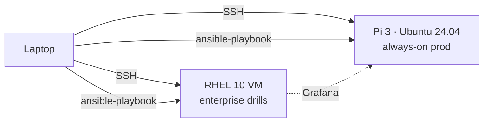

# lab-infra

Rebuild my entire two-node Linux lab with one command.

> [!info] Status
> **Phase 0 — repo initialized.** Ansible roles arrive in Phase 3 (Week 9). Until then, `scripts/` and `troubleshooting/` accumulate by hand as I work through Phase 1 drills.

## Architecture

| Node | Role | Runs |
|---|---|---|
| Pi 3 (Ubuntu 24.04, arm64) | always-on prod | Unbound, DHCP, Nginx+TLS, node_exporter, restic, fail2ban |
| RHEL 10 VM | disposable enterprise | RHCSA/LFCS drills, LVM, SELinux, Grafana, Ansible control |

## Quick start

> [!warning] Phase 0 — not yet runnable
> `site.yml` arrives in Phase 3. This section gets filled in then.

## What's in here

| Path | Purpose |
|---|---|
| `docs/decisions.md` | Architecture Decision Records (ADRs) — what was chosen, what was rejected, and why |
| `runbooks/` | One operational runbook per service |
| `troubleshooting/` | Dated troubleshooting entries from lab drills |
| `scripts/` | Bootstrap, health probes, backup scripts (Phase 1+) |
| `diagrams/` | Architecture diagrams (README has an inline mermaid version until this is populated) |

## Lab evolution

| Date | Change | ADR |
|---|---|---|
| 2026-11 | Initial lab: Pi 3 + RHEL 10 VM, no Proxmox | [ADR-001](docs/decisions.md#adr-001-no-proxmox--two-node-lab-on-constrained-hardware) |
| 2027-__ | _planned: mini PC + Proxmox (budget dependent)_ | — |

## Design decisions

- **Two-node lab, no Proxmox** — no spare hypervisor hardware; local VM snapshots replace rollback. See [ADR-001](docs/decisions.md#adr-001-no-proxmox--two-node-lab-on-constrained-hardware).
- **RHEL VM + Ubuntu Pi (dual-distro)** — learn concepts once, execute twice; RHEL family ≈ enterprise, Ubuntu ≈ web/cloud.
- **systemd timers over cron for new work** — logging, catch-up, dependencies. Cron retained where inherited.
- **Podman + quadlets over Docker** — daemonless, rootless, RHEL-family default. Arrives Phase 4.
- **Ansible over shell scripts** — idempotent, reviewable, rebuilds from bare metal. Arrives Phase 3.
- **SELinux/AppArmor left on** — hardening as baseline, not add-on.

## License

MIT — see [LICENSE](LICENSE). Fork it, this is a learning repo.